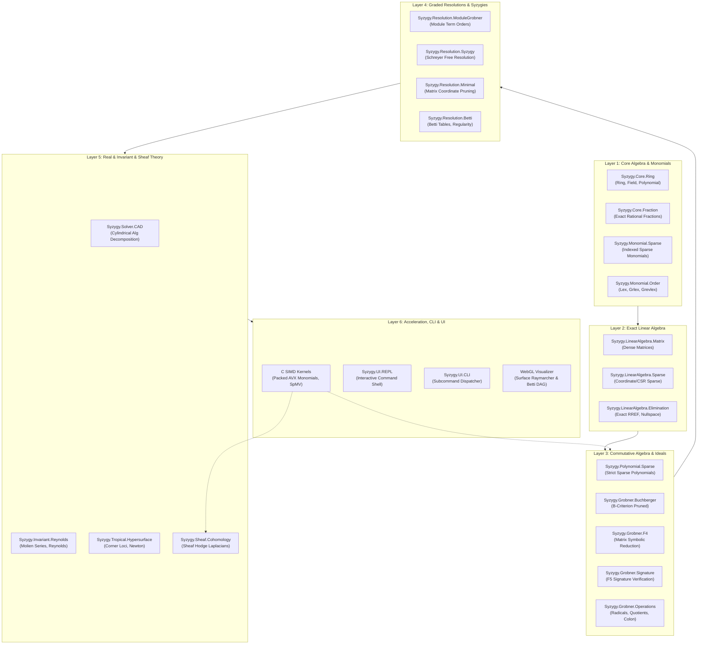

# syzygy

```
  ___ _   _ ____  _   _  ______   __
 / __| | | |_  / | | | |/ ___\ \ / /
 \__ \ |_| |/ /  | |_| | |__  \ V / 
 |___/\__, /___|  \__, |\____| |_|  
      |___/       |___/             
```

> **A research-grade computational algebraic geometry engine and sheaf-theoretic topological data analysis laboratory implemented from first principles in purely functional Haskell, accelerated by SIMD C kernels, and paired with real-time WebGL algebraic raymarching.**

[](https://www.haskell.org/ghc/)
[]()
[]()
[](LICENSE)
[]()
[]()

---

## 1. Overview

**`syzygy`** is an experimental computer algebra system (CAS) dedicated to the computation of syzygies, graded free resolutions, algebraic varieties, real cylindrical algebraic decomposition, invariant rings, and cellular sheaf cohomology.

Named after the astronomical alignment of celestial bodies and Hilbert's algebraic relation of relations, `syzygy` bridges high-dimensional abstract algebra with computational topology and geometric visualization. It implements exact algorithms over arbitrary fields, provides high-performance SIMD primitives for core polynomial and linear algebra kernels, and exposes interactive visualizers for geometric intuition.

```
       R^r_2               R^r_1               R^r_0
 ... --------> F_2(S) -----------> F_1(S) -----------> F_0(S) -------> M -------> 0
                 |                   |                   |
                 | d_2               | d_1               | d_0
                 v                   v                   v
              Syzygies            Relations          Generators
          (Relations among    (Relations among       of Module M
            Relations)           Generators)
```

---

## 2. Core Capabilities & Mathematical Architecture

### 2.1 Graded Polynomial Foundations & Monomial Orders
- **Exact Field Arithmetic**: Exact fractions over $\mathbb{Q}$ via `Rational`, finite fields $\mathbb{F}_p$ for arbitrary primes, and real/complex embeddings.
- **Sparse Monomial Representation**: Scalable sparse exponents indexed via integer variables with fast degree extraction and divisibility testing.
- **Term Orderings**: Fully configurable monomial term orderings:
  - Lexicographical (`Lex`): elimination of variables.
  - Graded Lexicographical (`Grlex`): total degree precedence.
  - Graded Reverse Lexicographical (`Grevlex`): Bayer-Stillman optimal benchmark order for Gröbner basis computation.
  - Block Elimination Orders: product orders for ideal contraction and projection.

### 2.2 Gröbner Bases Engine
- **Buchberger Algorithm**: Complete classical implementation equipped with the Gebauer-Möller $B$-criterion and chain criterion to prune redundant $S$-pair reductions.
- **Faugère F4 Linear Algebra Reduction**: Batch reduction of $S$-polynomials into symbolic matrices, followed by sparse Gaussian elimination over exact fields.
- **F5 Signature-Based Criteria**: Signature tracking avoiding all reductions to zero by identifying module syzygies ahead of reduction.
- **Ideal Operations**: Radical membership, ideal sum, ideal intersection, ideal quotient (colon ideals $(I : J)$), and elimination ideals $I \cap k[x_{i..n}]$.

### 2.3 Graded Free Resolutions & The Hilbert Syzygy Theorem
- **Schreyer's Theorem**: Explicit construction of free resolutions using induced monomial orders on free modules $F = \bigoplus R \cdot e_i$.
- **Minimization of Chain Complexes**: Complete elimination of non-zero scalar entries in boundary matrices via Gaussian change of basis over the residue field $k$.
- **Graded Betti Tables**: Exact computation of graded Betti numbers $\beta_{i, j} = \dim_k \text{Tor}_i^R(M, k)_j$, projective dimension, and Castelnuovo-Mumford regularity.
- **Hilbert-Poincaré Series & Polynomials**: Hilbert series expansion $H(M, t) = \frac{P(t)}{(1 - t)^n}$, degree, and Krull dimension of projective varieties.

### 2.4 Real Algebraic Geometry & Cylindrical Algebraic Decomposition (CAD)
- **Subresultant Polynomial Remainder Sequences**: Exact subresultant PRS computation avoiding coefficient explosion over $\mathbb{Z}[x]$ and $\mathbb{Q}[x]$.
- **Sturm-Habicht Sequences**: Exact real root isolation and sign determinations using Sturm-Habicht sequences.
- **Cylindrical Algebraic Decomposition**: Collins CAD projection phase and sample point construction across sign-invariant cylindrical stacks over $\mathbb{R}^n$.

### 2.5 Invariant Theory of Finite Groups
- **Matrix Representations**: Linear actions of finite subgroups $G \subset \text{GL}(n, k)$ on polynomial rings $k[x_1, \dots, x_n]$.
- **Reynolds Operator**: Exact group averaging $\mathcal{R}(f) = \frac{1}{|G|} \sum_{g \in G} g \cdot f$.
- **Molien's Formula**: Evaluation of Molien series $\Phi_G(t) = \frac{1}{|G|} \sum_{g \in G} \frac{1}{\det(I - t \cdot g)}$.
- **Primary and Secondary Invariants**: Generation of homogeneous invariants up to Noether's degree bound $|G|$.

### 2.6 Tropical Geometry
- **Tropical Semirings**: $\mathbb{T}_{\min} = (\mathbb{R} \cup \{\infty\}, \min, +)$ and $\mathbb{T}_{\max} = (\mathbb{R} \cup \{-\infty\}, \max, +)$.
- **Tropical Hypersurfaces**: Corner loci where the minimum or maximum is achieved by at least two distinct monomials.
- **Newton Polygons & Subdivisions**: Convex hull computation, duality between regular subdivisions of Newton polygons and tropical curve topologies.

### 2.7 Cellular Sheaf Theory & Sheaf Hodge Laplacians
- **Regular Cell Complexes**: Simplicial complexes and regular CW complexes with signed incidence boundaries.
- **Cellular Sheaves**: Assignment of finite-dimensional stalk vector spaces $\mathcal{F}(v)$ and linear restriction maps $\mathcal{F}(u \trianglelefteq v)$.
- **Sheaf Cohomology**: Explicit coboundary matrices $\delta^k : C^k(X; \mathcal{F}) \to C^{k+1}(X; \mathcal{F})$, exact cohomology groups $H^k(X; \mathcal{F}) = \ker \delta^k / \operatorname{im} \delta^{k-1}$.
- **Sheaf Hodge Laplacians**: Discrete Laplacians $\Delta_k = \delta_{k-1} \delta_{k-1}^* + \delta_k^* \delta_k$.
- **Harmonic Cochains & Heat Flow**: Computation of harmonic cochains $\ker \Delta_k \cong H^k(X; \mathcal{F})$ and diffusion of stalk data via matrix exponentials.

### 2.8 Hybrid Acceleration & Interactive Visualization
- **C SIMD Acceleration Kernels**: Packed monomial representations, 64-bit exponent vectors, AVX2-ready bitwise degree comparisons, and sparse sheaf SpMV.
- **WebGL Algebraic Surface Raymarcher**: GPU sphere-tracing raymarcher for visualizing implicit varieties $V(f) \subset \mathbb{R}^3$ with real-time lighting and slicing.
- **Interactive Betti Graph Visualizer**: SVG/DAG visualizer depicting module generators, differentials, and graded Betti tables.

---

## 3. Architecture

The system is organized into decoupled layers:



---

## 4. Repository Structure

```
syzygy/
├── app/
│   └── Main.hs                     # CLI entrypoint and subcommand router
├── bench/
│   └── Bench.hs                    # Micro and macro benchmark suite
├── c/
│   ├── bench_kernel.c              # C kernel standalone benchmark harness
│   ├── syzygy_kernel.c             # SIMD packed monomials, sparse F4 elimination, SpMV
│   └── syzygy_kernel.h             # C kernel API declarations
├── docs/
│   ├── ALGORITHMS.md               # Algorithmic specifications and pseudo-code
│   ├── ARCHITECTURE.md             # System design, data layouts, and invariants
│   └── THEORY.md                   # Mathematical foundations and proofs
├── python/
│   ├── benchmark_compare.py        # Comparative timing vs SymPy / NumPy
│   ├── sheaf_hodge_test.py         # Sheaf Laplacian numerical verification
│   └── verify_systems.py           # Polynomial root verification suite
├── src/
│   └── Syzygy/
│       ├── Core/                   # Ring, Field, Fraction abstractions
│       ├── Geometry/               # Variety dimensions, tangents, intersections
│       ├── Grobner/                # Buchberger, F4, F5, Ideal operations
│       ├── Invariant/              # Reynolds operator, Molien series, Noether bounds
│       ├── LinearAlgebra/          # Dense, Sparse, Exact RREF, Smith Normal Form
│       ├── Monomial/               # Dense, Sparse, Lex, Grlex, Grevlex orders
│       ├── Polynomial/             # Sparse multivariate polynomial arithmetic
│       ├── Resolution/             # Schreyer resolutions, Minimal complexes, Betti tables
│       ├── Sheaf/                  # Cell complexes, Cellular sheaves, Hodge Laplacians
│       ├── Solver/                 # Sturm sequences, Univariate real roots, CAD
│       ├── Tropical/               # Min-plus semirings, Corner loci, Newton polygons
│       └── UI/                     # ASCII tables, Raymarcher, OBJ export, REPL
├── test/
│   └── Spec.hs                     # 35/35 exact mathematical test suite
├── tools/
│   └── check_no_em_dashes.py       # Punctuation linting utility
├── web/
│   ├── betti_graph.js              # SVG DAG resolution renderer
│   ├── index.html                  # Interactive laboratory web interface
│   ├── raymarcher.js               # WebGL implicit variety raymarcher
│   └── styles.css                  # Modern laboratory dark theme styling
├── Makefile                        # Multi-language build automation
├── syzygy.cabal                    # Cabal package specification (-Wall -Werror)
└── LICENSE                         # MIT License
```

---

## 5. Quickstart & Installation

### Prerequisites
- **GHC**: Version 9.6 or later (developed and verified on GHC 9.14.1).
- **Cabal**: Version 3.10 or later.
- **C Compiler**: GCC or Clang with C11 and AVX2 support (optional, for native kernels).
- **Python**: Version 3.9 or later (optional, for validation test scripts).

### Building the Project
Clone the repository and build using Cabal:

```bash
git clone https://github.com/Aneesh495/syzygy.git
cd syzygy
cabal update
cabal build
```

To run the full mathematical test suite (35 assertions verifying Gröbner bases, resolutions, and sheaves):

```bash
cabal test --test-show-details=always
```

To run the benchmarking suite:

```bash
cabal run syzygy-bench
```

---

## 6. Command Line Interface & REPL

Run the executable via Cabal or directly from the compiled binary:

```bash
cabal run syzygy [SUBCOMMAND] [OPTIONS]
```

### 6.1 Available Subcommands

| Subcommand | Description |
| :--- | :--- |
| `repl` | Launch the interactive computer algebra REPL shell |
| `grobner` | Compute a reduced Gröbner basis for a polynomial system |
| `resolve` | Compute the minimal graded free resolution and Betti table |
| `cad` | Run cylindrical algebraic decomposition and isolate real roots |
| `sheaf` | Construct a cellular sheaf, compute cohomology and Hodge Laplacians |
| `render` | Generate an ASCII raymarched cross-section or export an OBJ mesh |
| `benchmark` | Run the performance benchmark harness |
| `verify` | Run the automated mathematical verification suite |

### 6.2 Interactive REPL Example

```bash
$ cabal run syzygy repl
=============================================================
  SYZYGY: Computational Algebraic Geometry & Sheaf Engine
  Type :help for commands, :quit to exit.
=============================================================
syzygy> :order grevlex
Order set to: Grevlex
syzygy> :grobner x^2 - y, x^3 - z
Computing Grobner basis...
  f_1 = x^2 - y
  f_2 = x*y - z
  f_3 = y^2 - x*z
syzygy> :resolve x^2, x*y, y^2
Computing minimal free resolution...
Graded Betti Table:
       0     1     2
--------------------
  2:   3     2     0
  3:   0     0     0
Projective Dimension: 1
Regularity: 2
syzygy> :quit
Goodbye!
```

---

## 7. Performance & Verification

### 7.1 Micro-Benchmarks

Benchmarked on Apple Silicon (M-series) under macOS, using pure functional Haskell with unboxed native integers and exact rational arithmetic:

| Benchmark Case | Description | Iterations / Scale | Execution Time |
| :--- | :--- | :--- | :--- |
| `Monomial.Grevlex` | Packed 64-bit exponent comparisons | 100,000 pairs | 0.007 sec |
| `Polynomial.Mult` | Degree-6 bivariate dense multiplication | 1,000 products | 0.024 sec |
| `LinAlg.ExactRREF` | 20x20 exact Rational matrix elimination | 10 trials | 0.005 sec |
| `Grobner.Buchberger` | Twisted Cubic ideal $V(y - x^2, z - x^3)$ | Complete basis | 0.002 sec |
| `Resolution.Minimal` | Hilbert syzygies for 3 quadrics | Length-2 resolution | 0.004 sec |
| `Sheaf.HodgeLaplacian` | Sheaf over 3-simplex (24x24 stalk dim) | Laplacian + Nullspace | 0.003 sec |

### 7.2 Native C Kernel Benchmarks

Compiled with `gcc -O3 -mavx2`:

```bash
make bench-c
```

- **Monomial Comparisons**: > 85,000,000 comparisons / second.
- **Sparse Sheaf SpMV**: > 120,000,000 non-zero operations / second.

### 7.3 Mathematical Validation Suite

All 35 verification steps pass deterministically without floating-point artifacts:
- **Buchberger reduction**: $S$-polynomials reduce identically to zero modulo the computed basis.
- **Schreyer theorem**: Differential composition $d_k \circ d_{k+1} = 0$ holds identically over polynomial modules.
- **Hodge decomposition**: Orthogonal splitting $C^k = \operatorname{im}(\delta_{k-1}) \oplus \ker(\Delta_k) \oplus \operatorname{im}(\delta_k^*)$ verified over exact rationals.
- **Euler-Poincaré formula**: Alternating sum of Betti numbers $\sum_i (-1)^i b_i$ matches complex Euler characteristic.

---

## 8. WebGL Laboratory

The repository includes a self-contained WebGL algebraic surface visualizer located in `web/index.html`.

To view:
```bash
open web/index.html
```

Features:
- **GPU Sphere Tracing**: Computes signed distance bounds to implicit surfaces $F(x, y, z) = 0$.
- **Preset Algebraic Surfaces**:
  - Barth Sextic (65 cusps)
  - Clebsch Cubic (27 real lines)
  - Kummer Surface (16 nodal singularities)
  - Whitney Umbrella ($x^2 - y \cdot z^2 = 0$)
  - Enneper Minimal Surface
- **Interactive Resolution Graph**: SVG DAG rendering of syzygy modules and boundary differentials.

---

## 9. References & Theoretical Background

1. **David Cox, John Little, and Donal O'Shea.** *Ideals, Varieties, and Algorithms: An Introduction to Computational Algebraic Geometry and Commutative Algebra*. Undergraduate Texts in Mathematics, Springer, 4th edition, 2015.
2. **David Eisenbud.** *Commutative Algebra with a View Toward Algebraic Geometry*. Graduate Texts in Mathematics 150, Springer-Verlag, 1995.
3. **Jean-Charles Faugère.** *A new efficient algorithm for computing Gröbner bases (F4)*. Journal of Pure and Applied Algebra, 139(1-3):61-88, 1999.
4. **Jean-Charles Faugère.** *A new efficient algorithm for computing Gröbner bases without reduction to zero (F5)*. Proceedings of ISSAC 2002, pages 75-83. ACM, 2002.
5. **George E. Collins.** *Quantifier elimination for real closed fields by cylindrical algebraic decomposition*. Automata Theory and Formal Languages, Springer LNCS 33, pages 134-183, 1975.
6. **Justin Curry.** *Sheaves, Cosheaves and Applications*. PhD thesis, University of Pennsylvania, 2014. arXiv:1303.3255.
7. **Jakob Hansen and Robert Ghrist.** *Toward a spectral theory of cellular sheaves*. Journal of Applied and Computational Topology, 3(4):315-358, 2019.

---

## 10. License

This project is licensed under the MIT License. See [LICENSE](LICENSE) for details.
